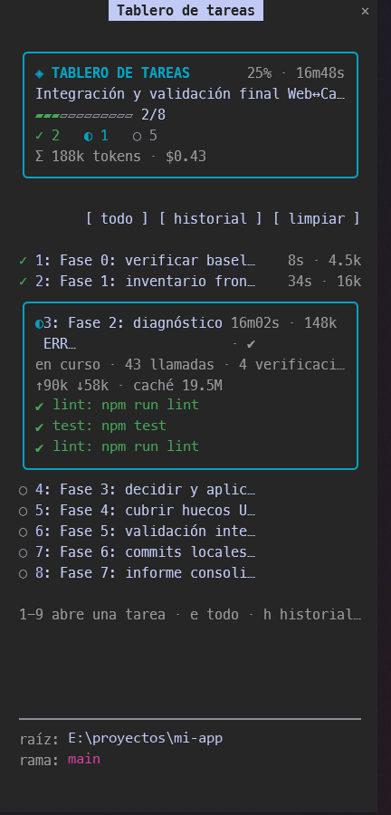

# agent-taskboard

> A live task board for Claude Code. It makes Claude plan before it builds, then shows every task, its status, time, subagents and checks in a side panel, and remembers your plans between sessions.

`agent-taskboard` is a [Claude Code](https://claude.com/claude-code) **mod**: it uses the official Mods API only. No MCP server, no background processes, no network, no files written outside Claude Code's own plugin store.



[Español](#español) · [Install](#install) · [What it does](#what-it-does) · [Configure](#configure) · [Privacy](#what-it-can-see-and-what-it-keeps) · [Develop](#develop)

## Install

Inside Claude Code:

```text
/plugin marketplace add YohanGarcia/agent-taskboard
/plugin install agent-taskboard@agent-taskboard
/reload-plugins
```

Or from a terminal:

```bash
claude plugin marketplace add YohanGarcia/agent-taskboard
claude plugin install agent-taskboard@agent-taskboard
```

Built and tested on Claude Code **2.1.296**. The Mods API is early access and may change between releases, so on a much newer version run `claude plugin validate` and `claude plugin test` before relying on it.

## What it does

- **Side panel with your tasks.** A card for the plan: goal, progress bar, percentage and working time (the hours a plan sat open between sessions are not counted), counters by status, and one row per task with its duration, subagents and check result. Press a task (or its number) to open its detail and action buttons.
- **A plan before the work.** Claude is told to register a plan for complex requests. If a request looks complex and no plan exists, `Edit`/`Write` are blocked until Claude registers one (switchable, see `planMode`).
- **Status from real events, not promises.** The first real tool call starts a task. Subagents are attached to the task they name (`t2: review types`). A test, build, lint or typecheck command that fails is recorded on the task, and the board **refuses to mark it done** until the check passes.
- **Plan mode and todo lists show up by themselves.** The plan you approve in plan mode and Claude Code's own `TodoWrite` list are mirrored on the board (statuses included); `plan`/`task` stay available as the explicit way.
- **Progress survives sessions.** The active plan and a history of up to 100 plans are stored per project. A plan that was in flight comes back paused.
- **History with detail.** Open any past plan, see its tasks and final states, and resume it.
- **Tokens and cost per task.** Each task shows what the main agent and its subagents spent (fresh input, output, cache) and the session cost while it ran, with a plan total. `/taskboard stats` prints the detail and the mod's own overhead.
- **Where you are.** The bottom of the panel shows the project root and the git branch, and follows a `git checkout` run in the shell.

### Commands

| Command | Does |
| --- | --- |
| `/taskboard` | Open the panel |
| `/taskboard history` | Show the history, numbered from the most recent (also in the panel) |
| `/taskboard history drop <n>` | Delete entry `n` from the history |
| `/taskboard history clear` | Empty the history |
| `/taskboard stats` | Tokens and cost per task, plus the mod's own per-request overhead (an estimate) |
| `/taskboard clear` | Archive the plan and empty the board |
| `/taskboard skip` | Do not require a plan for the current request |
| `/taskboard close` | Close the panel |

### Panel keys

`1-9` open a task · `i` start · `d` done · `b` block · `f` failed · `e` expand all · `h` history · `l` clear · `o` skip plan · `r` resume a past plan and `x` delete it (in history).

### How Claude talks to it

The mod registers two tools the model can call, both served by the mod itself (not an MCP server):

- `mcp__agent-taskboard__plan` with `{ goal, tasks }` registers the plan.
- `mcp__agent-taskboard__task` with `{ id, status, note? }` updates a task.

It also adds a short section to the system prompt (about 150 words) explaining when to use them.

## Configure

Run `/plugin configure agent-taskboard@agent-taskboard` or set them in settings under `pluginConfigs`.

| Option | Default | Meaning |
| --- | --- | --- |
| `language` | `auto` | `auto` follows the system locale (Spanish for `es-*`, English otherwise), or force `es` / `en` |
| `mode` | `full` | `full` registers the `plan`/`task` tools, adds the rules to the prompt and guards `Edit`/`Write`. `light` does none of that: no tools, no prompt rules, no guard; the board only mirrors plan mode and `TodoWrite` and keeps its time, checks and token accounting (no per-request overhead) |
| `planMode` | `block` | (only in `full`) `block` blocks Edit/Write until there is a plan, `warn` only shows a notice, `off` does nothing |
| `minPromptChars` | `240` | Length above which a request that names an action counts as complex |
| `extraChecks` | empty | Extra commands that count as a check, comma separated (`artisan test, composer test`) |
| `openOnStart` | `true` | Open the panel when a session starts |

Recognised checks out of the box: `npm|pnpm|yarn|bun run test/build/lint/check`, `vitest`, `jest`, `pytest`, `go test`, `cargo test/check/build`, `dotnet test`, `tsc`, `eslint`, `ruff`, `mypy`, `claude plugin test/validate`, `make test`.

## What it can see and what it keeps

It observes your prompts (to detect complex requests), tool calls (names and inputs, to attribute work and checks), subagents and the token counts of each model request (numbers only, to attribute them to a task). It only answers with its own plan and task tools, and with a refusal of `Edit`/`Write` while a plan is missing. It **never** rewrites a tool call or a prompt.

It keeps the plan, the history and check commands (clipped to 80 characters) in Claude Code's own per-plugin store, on your machine. It makes no network requests, runs no processes of its own and writes no files. To show the branch it **reads one file**, `.git/HEAD` (walking up from the project folder); it never runs `git`.

## Known limits

- It fills from `plan`/`task`, plan mode (`ExitPlanMode`) and `TodoWrite`. Newer task tools (`TaskCreate`/`TaskUpdate`) are not mirrored yet.
- Tokens are attributed to the task that is active when the request finishes; requests made before the first task starts count as "no task". Cost is the session's cost while a task ran, so work on two tasks in parallel is not split.
- "Complex request" is a heuristic (action words, lists, length) and can be wrong either way. Use `planMode: warn` or `/taskboard skip`.
- A check is recognised by its command text, so unusual script names need `extraChecks`.
- Subagents with no task id in their description go to the active task, which may not be theirs.

## Develop

```bash
git clone https://github.com/YohanGarcia/agent-taskboard
claude --plugin-dir ./agent-taskboard       # load it for one session
claude plugin validate ./agent-taskboard
claude plugin test ./agent-taskboard
```

Layout: `hooks/register.tsx` (the hooks and the panel), `hooks/logic.ts` (pure functions), `hooks/i18n.ts` (messages), `types/index.d.ts` (the `$.state` contract), `tests/`. See [CONTRIBUTING.md](CONTRIBUTING.md).

## Español

`agent-taskboard` es un **mod** de Claude Code que hace que Claude planifique antes de implementar y muestra en un panel lateral las tareas de la sesión con su estado, progreso, duración, subagentes y verificaciones. Conserva tus planes entre sesiones y guarda un historial por proyecto.

```text
/plugin marketplace add YohanGarcia/agent-taskboard
/plugin install agent-taskboard@agent-taskboard
/reload-plugins
```

- **Plan nativo y lista de tareas:** el plan que apruebas en modo plan y la lista `TodoWrite` de Claude Code aparecen solos en el tablero, con sus estados.
- **Modo ligero:** con `mode: light` no registra herramientas, no añade reglas al prompt ni bloquea Edit/Write; solo refleja el plan nativo y `TodoWrite`. Sin sobrecosto de tokens. `full` es el valor por defecto.
- **Limpiar el historial:** `/taskboard history drop <n>` borra una entrada (1 es la más reciente), `/taskboard history clear` lo vacía, y en el detalle de una entrada la tecla `x` la borra.
- **Tiempo de trabajo:** la duración de un plan suma solo los tramos en que hubo trabajo; las horas con el plan abierto entre sesiones no cuentan.
- **Estados desde eventos reales:** una verificación que falla (tests, build, lint, tsc) impide marcar la tarea como hecha.
- **Idioma:** `language: auto` sigue el idioma del sistema; también `es` o `en`.
- **Modo del plan:** `block` bloquea Edit/Write sin plan, `warn` solo avisa, `off` no vigila.
- **Dónde estás:** el pie del panel muestra la raíz del proyecto y la rama de git.
- **Privacidad:** no usa red ni procesos; solo lee `.git/HEAD` para la rama y guarda todo en el almacén local del plugin.

## License

[MIT](LICENSE)
